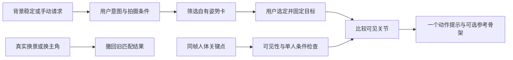

# 将姿势参考库用于观景 App 的方案

核查日期：2026 年 11 月 7 日。结论：借鉴图库的分类、多角度浏览和检索方式，建设适合摄影的自有姿势库；先实现「选姿势＋局部动作指导」，有真实反馈后再训练推荐模型。

## 本次已完成的下载与核查

GitHub 上存在多个同名仓库。核对发现，`TerrenceHsu/ai-pose-gallery` 是中文版上游 [anhao/ai-pose-gallery-zh](https://github.com/anhao/ai-pose-gallery-zh) 的分支，本次选用上游固定版本：

```text
488939139c69acfe078372b39d4bd0c457dc060e
```

本地目录为 `third_party/ai-pose-gallery-zh/`。通过 GitHub 插件核验仓库、版本与文件；Git 连接被重置后，改从 GitHub 原始文件域名按固定版本下载。149 个源码及文本索引文件共 8,548,501 字节，逐文件与 GitHub 树中的 Git blob SHA-1、大小核对一致。没有执行上游脚本、安装依赖或配置生成服务。

**这是一份源码与索引研究快照，不是含全部图片、可直接启动的完整图库。** 没有下载 `img/`、`thumbs/` 和其他图片文件，也没有给 App 增加图片资源或训练模型。缺少图片的研究快照不应作为成品画廊交付。

下载清单为 `third_party/ai-pose-gallery.download.json`，下载结果为 `third_party/ai-pose-gallery.download-report.json`，索引审计为 `third_party/ai-pose-gallery-zh/FRAMECOACH_LOCAL_AUDIT.json`。研究快照与索引不提交到我们的 GitHub 仓库。

## 图库能提供什么

下面是读取固定版本 `data/pose-zh.json` 的统计，而非直接采用 README 中的宣传数字。

| 项目 | 实际内容 |
| --- | --- |
| 视角条目 | 1,439 条 |
| 独立动作组 | 288 组，按「体系＋姿势编号」分组 |
| 动作分类 | 26 类 |
| 视角 | 正面、斜侧、侧面、俯视、仰视 |
| 标准全身单人 | 365 条，73 组 |
| 上半身单人 | 400 条，80 组 |
| 其他体系 | 全身单人成人向 399 条、双人成人向 275 条 |
| 坐标与教学标注 | 没有关节坐标、动作容差、机位标定、真实光线、神态或摄影偏好标签 |

标准全身和上半身合计 153 组、765 个视角条目，只能作为研究分类的范围，不表示全部适合普通摄影。还需逐动作检查适用性。一组成人向动作少一个仰视条目，因此不能假设所有组都恰好有五张图，也不能把五个视角当作五种独立动作。

索引的九个字段是 `id`、`体系`、`姿势编号`、`分类`、`姿势名称`、`角度`、`缩略图`、`原图`、`检索`。上游源码的分组、组合筛选、多角度切换值得参考；这些字段无法直接回答「当前人物哪里需要调整」。

该项目目前还包含服装、人像、AI 生图与 ComfyUI 功能。本方案聚焦拍摄辅助，保留我们的 Android 原生界面和 CameraX，不将整个 Web 工作台嵌入相机，也不接入其生图 API。

## 图片使用条件决定接入方式

[固定版本 LICENSE](https://github.com/anhao/ai-pose-gallery-zh/blob/488939139c69acfe078372b39d4bd0c457dc060e/LICENSE) 明确排除图片和原始数据，并声明素材不得商用。[原作者站点](https://ai-pose-gallery.pages.dev/) 目前允许单张用于作品参考，同时明确禁止批量下载及图片再分发、转载、转售，且限制用于表现真实人物的用途。摄影指导能否使用这些图，需要原作者另行澄清，不能仅凭镜像仓库公开就推定允许。

因此，当前不把图片放进 APK、可下载素材包、远程图片库或训练集，也不先提取骨架、描图后当作已经解决素材使用条件。

可行路线：

| 路线 | 所需条件 | 建议 |
| --- | --- | --- |
| 使用原图库图片及其派生模板 | 取得覆盖真实人物摄影指导、App 展示、分发、处理与相关用途的明确许可；训练用途单独核对 | 许可明确后再实施 |
| 自有摄影姿势库 | 自行设计动作，用自摄素材或明确许可的素材制作示意图，记录图片、人物及用途状态 | 推荐，减少后续替换成本 |
| 仅研究界面与分类设计 | 保留代码许可，使用原创中文指导和自有资源；不复制未获准的图片或原始数据用于发布 | 可以作为当前设计工作基础 |

本次未向作者发送消息，也没有替用户申请或取得授权。

## 用户实际怎样使用

1. 手机对准背景，沿用约 2.5 秒稳定触发；人物正常摆动作不应让背景观察反复清零。
2. 人像模式显示三个候选姿势卡，例如「自然站立」「窗边坐姿」「侧身回看」，并说明适用条件。第一版由用户选择站姿、坐姿、是否有椅子等条件，不能假装 Android 已经识别了所有道具与环境。
3. 用户选定姿势，App 固定本次目标，展示自有示意图；可以按需打开简洁的目标骨架。参考图不覆盖整个人脸。
4. 有可靠的同帧关节依据时，一次只给一个可执行提示，例如「左手抬到腰部附近」；未看清手部时，显示参考卡和通用引导，不显示精确箭头。
5. 动作接近目标后，提示「动作已接近参考，可尝试拍一张」。摄影师仍可选择不同版本，不给人物打审美分。
6. 用户主动换姿势才切目标；真正换景、翻转镜头、改变主角或切模式时，清空旧目标匹配结果。

「选什么动作」和「怎样接近已选动作」分开处理。匹配器不能为了追随当前姿态，不断把推荐目标换成另一个动作。



## 怎样接入现有 Android 代码

| 现有位置 | 已有能力 | 后续改动 |
| --- | --- | --- |
| `CameraSession.kt` | CameraX、ML Kit 人脸和姿态分析，最多约每秒分析 5 帧 | 给观察增加帧时间、会话版本与匹配目标版本；保持检测和预览坐标一致 |
| `Models.kt` | 肩、肘、腕、髋、膝、踝共 12 点，入画阈值 0.65 | 增加 `PoseTemplate`、`PoseMatch`、必要关节集合、视角和拍摄条件 |
| `Coach.kt` | 构图、光线、动作和表情规则 | 候选姿势筛选与匹配提示分开，保留测量依据与创作建议标签 |
| `GuideOverlay.kt` | 构图线、目标点、当前人体骨架 | 区分当前骨架和目标骨架，仅绘制可靠且适用的部分 |
| `MainActivity.kt` | 稳定触发、模式、氛围、提示卡 | 增加候选姿势卡、锁定目标、换一组和关闭参考功能 |
| `SceneStability.kt` | 手持稳定观察与真实移动撤回 | 保持现有行为，为新姿势交互验证稳定性回归 |

这些是拟议改动，本次没有修改 Android 实现或生成新 APK。

### 匹配要遵守的几何边界

- [ML Kit 官方文档](https://developers.google.com/ml-kit/vision/pose-detection) 提供 33 个关键点；我们的代码目前只使用其中 12 个。第一版用这 12 点做粗动作匹配，不据此判断手指细节或精确眼神。
- `InFrameLikelihood` 表示关键点在画面内的可能性，不是定位误差或动作正确率。沿用 0.65 只作初始入画筛选，还需要视角一致、关节可见、比例合理和时间连续性检查。
- 标准化平移和尺度，比较肘、膝角度、手腕相对肩髋的位置和肩髋关系。不要随意旋转骨架消除本来需要保留的身体倾斜；也不能用二维变换把正面模板变成侧面模板。
- 当前检测使用 `COORDINATE_SYSTEM_VIEW_REFERENCED`，匹配模板与叠加层必须显式遵循同一套方向、预览裁切和镜像变换。统一处理人体左右与画面左右，避免前置镜头反向指导。
- 必要关节缺失时不填零坐标、不计满分。半身照只使用对应的半身模板；姿势相似程度不等于作品质量。
- 官方姿态检测只提供一个人的姿态。多人情况下不能把该骨架默认分配给最大人脸；第一版暂停自动关节纠正，仍可手动浏览姿势卡。后续若做多人，需要新增主角关联与跟踪验证。
- 官方说明要求人脸出现；背身、遮脸、强遮挡时可能失效。此时提供参考卡或人工确认，不伪造目标误差。
- 使用时间平滑、触发容差和提示冷却，降低关节抖动导致的提示跳变。具体阈值要用真实相机样本及红米 K80 调整，当前不写成已经测得的准确率。
- 不根据 ML Kit 的实验性 Z 值或白模图推算真实三维距离、关节负荷与可移动空间。

## 姿势卡还需要补充什么

每张自有姿势卡应记录以下信息。上游九字段索引不具备这些内容，需要重新制作和审核。

| 数据组 | 内容 |
| --- | --- |
| 拍摄条件 | 单人、站坐靠、全身半身、所需椅子或墙面、适用视角、是否需要行走空间 |
| 动作说明 | 身体方向、手部落点、重心变化和可替代动作；以舒适为前提 |
| 几何模板 | 可选的规范坐标关节、必要关节、比较特征与容差；标注人工审核状态 |
| 摄影表达 | 适合的构图与留白、可选目光方向、用户希望表达的自然或安静等氛围 |
| 光线条件 | 有依据的适用说明；不能从均匀白模推断真实人脸受光 |
| 来源与用途 | 自摄或许可来源、版本、人物及图片用途、App 展示和训练是否分别允许 |

一个尚未制作完成的原创模板，可先用下列结构表达状态，不预填假的关键点：

```json
{
  "id": "fc-own-standing-001",
  "origin": "planned_self_created",
  "person_count": 1,
  "framing": "full_body",
  "posture": "standing",
  "view": "front_oblique",
  "required_props": [],
  "required_joints": ["LEFT_SHOULDER", "LEFT_ELBOW", "LEFT_WRIST", "LEFT_HIP"],
  "landmarks": null,
  "geometry_status": "not_annotated",
  "asset_status": "not_created",
  "review_status": "pending",
  "app_display_eligible": false,
  "training_eligible": false
}
```

## 与现有摄影点评库的关系

现有本地视频库共 129 个待审核案例，分构图、神态、姿态、情感表达和光线五维。它能帮助解释「为什么这样摆、为什么保留这块环境」，姿势库则帮助展示「动作是什么样」。两者互补，但不能互相替代。

例如，用户希望拍安静的窗边半身照：先确认有可用座位，再推荐适合半身的放松坐姿；用肩肘腕位置提供粗动作提示，用原创文案建议目光停在窗外；构图继续检查视线方向留白和环境叙事。不能从「靠近窗」自动断言脸已经获得柔光，也不能从姿态断言人物真实情绪。

将点评原则关联到姿势卡时，保留案例编号、人工审核状态、适用条件和反例。129 个案例尚不能直接当作已获许可的训练集；AI 修改示范、反讽、不同照片比较也不能变成真实拍摄优化对。

## 实施顺序与验收

### 第一阶段：40 个自有姿势卡

建议制作 12 个站姿、12 个坐姿、8 个靠姿、8 个轻微行走或回看动作，共 40 个动作。每个优先提供正面和斜侧两个版本。这是制作目标，当前尚未完成。采用自摄、原创绘制或另行许可的资源，不从未获准的图库图像描摹或批量提骨架。

先实现离线浏览、按拍摄条件筛选、收藏、选定目标和参考图显示。风光模式保持原逻辑。不要一次把整个原图库或上游 React、生图依赖装进 APK。

### 第二阶段：单人局部动作指导

为自有素材提取并人工复核关节模板。先验证站姿和半身手部的少量提示，再扩大到坐姿和轻微动作。缺失关节、多人或不兼容视角降级为参考卡。一次只纠正一个部位，人物动作不能改变已锁定目标，也不能清空背景稳定进度。

需要覆盖的验收场景：前后镜头与横竖屏、预览裁切、人体左右、半身缺腿、遮挡、背身、多人、跟踪丢失、真实换景、轻微手抖以及相机切后台。用受控姿态变化检查提示方向，再让摄影者盲评提示是否自然、可执行。

红米 K80 上记录进入辅助时间、提示跳变与误报、匹配耗时、内存和持续使用温升；与当前版本比较。现有每秒约 5 次分析为起点，性能实测后再调整，不承诺其他机型或白模图上的速度就是 K80 表现。

### 第三阶段：用真实反馈改进推荐

由用户主动选择保存拍摄意图、候选、采用或跳过的理由，以及确实发生的同场景调整。先比较规则筛选与人工选择的结果，有足够、允许训练的真实偏好数据后，再训练小型排序器。

同一个动作的不同视角、同一拍摄场景与同一人物不应跨训练和评测集合。评测要包含未见过的人物、场景及视角。1,439 个视角条目不是 1,439 个独立的摄影训练样本，更不是改进建议的监督标签。

第一、二阶段可以沿用现有端侧 SDK 和本地规则，不新增按次云端 API 调用。实际成本主要在自有素材制作、标注与真机验证；本次没有产生模型训练或生成服务调用。

## 可立即采用的决策

采用「自有姿势参考卡＋现有 ML Kit 粗动作匹配＋摄影规则解释」作为下一版方向。上游代码和索引用于研究分类及浏览体验；图片能否使用，等原作者明确许可后再决定。先做小规模可审核的单人版本，再依据实际拍摄反馈扩大。
