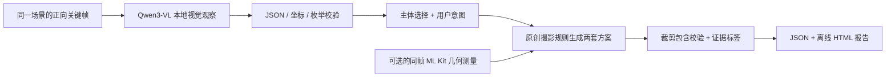

# FrameCoach Vision 0.1 · 摄影指导模型原型

这是一套**可在电脑本地运行的组合模型**：Qwen3-VL-2B-Instruct 负责看图，严格结构化校验负责拒绝无效观察，原创摄影规则负责生成两套可比较的方案。输入一张照片，输出主体/背景观察、参考裁剪框、构图及动作表情建议，以及一个可直接打开的 HTML 报告。

基础权重保留原样，**没有进行摄影审美微调，也没有训练审美排序器**。两套方案的顺序由用户的拍摄意图决定，不代表学会了评判哪张更美。当前是桌面原型，尚未集成到 Android 0.2 APK，也没有完成红米 K80 量化部署或真机性能验证。

## 模型怎样工作



- 视觉观察：人物、物体、地标的粗框，天空、水面、道路、窗户等背景区域；这些是模型估计，不是分割结果或精确三维测量。采用 LM Format Enforcer 在逐 token 解码时限制 JSON 字段和标签，之后仍做独立坐标/一致性校验。
- 主体选择：默认在人像意图中参考最大人物；可以点选其他主体，点击未命中时不擅自换人。
- 两套方案：「突出主体」提供保留整个已识别主体的参考裁剪；「保留环境」保留全画幅并按背景提供提示。裁剪框是已有画面内的取景比较，不是相机外部空间的重建。
- 动作和表情：按「自然 / 安静 / 轻快」给可选动作，不诊断情绪。有独立的同帧单人关键点时才启用对应的手部几何提示；多人时关闭该关联。
- 依据标签：`model_geometry` 为模型粗框，`model_hypothesis` 为语义推测，`measured_geometry` 为外部同帧几何，`creative_option` 为创作选项。每条提示同时给出依据和已有知识来源 ID。
- 模型输出解析失败时保存原始响应，状态为 `fallback`，只显示明确标识的通用方案；不把无效输出包装成成功识别。

## Windows 运行

需要 Python 3.11 或 3.12。推荐有约 8GB 显存的 NVIDIA GPU；CPU 路径也提供，但本轮不承诺其速度。初始化需联网下载依赖与公开模型权重，建议预留 15GB 磁盘空间。推理本身只读本地文件，不上传照片、不需要付费 API Key。

在项目根目录执行：

```powershell
powershell -NoProfile -ExecutionPolicy Bypass -File vision/scripts/setup-windows.ps1
powershell -NoProfile -ExecutionPolicy Bypass -File vision/scripts/run-windows.ps1 analyze "D:/Photos/example.jpg" --intent subject --mood natural --output vision/reports/local-my-photo
```

默认新建 `.tools/vision-venv`，安装 CUDA 12.6 版 PyTorch，再下载公开基础权重。需要兼容 CUDA 12.6 的 NVIDIA 驱动。若已有支持 Qwen3-VL 的 CUDA PyTorch 环境，可以复用其只读包，新增依赖仍装在项目虚拟环境：

```powershell
powershell -NoProfile -ExecutionPolicy Bypass -File vision/scripts/setup-windows.ps1 -EnvironmentPath .tools/vision-venv311 -PythonExe "D:/your-conda-env/python.exe" -ReuseInstalledTorch
```

`run-windows.ps1` 默认优先使用 `.tools/vision-venv`，不存在时查找 `.tools/vision-venv311`，也可传入 `-EnvironmentPath`。它会按虚拟环境配置设置 DLL 搜索路径；无需修改全局 Python，也不使用跳过 OpenMP 检查的环境变量。

运行后打开输出目录中的 `report.html`，或读取 `result.json`。HTML 自带图片和样式，可离线查看，没有远程脚本。照片、模型大文件、本地推理报告和私人训练数据默认不提交 Git。

可选参数：

| 参数 | 作用 |
| --- | --- |
| `--intent subject / environment / landscape` | 突出主体、环境叙事、风光优先 |
| `--mood natural / quiet / lively` | 用户选择的表达氛围 |
| `--subject-x 600 --subject-y 450` | 点选主体，正向原图归一化坐标 0–1000 |
| `--aspect 0.75` | 尝试 3:4 裁剪；无法包含完整主体时保留原画幅 |
| `--device cuda:0 / cpu / auto` | 推理设备 |
| `--scene-id shot-001 --measurements geometry.json` | 可选同帧外部测量，格式见下文 |

退出码：0 为结构化分析成功，3 为明确降级的通用方案，2 为输入或运行环境错误。结构化成功仅说明输出符合协议，**不保证视觉判断正确**。

## 权重与复现

- 基础模型：[Qwen/Qwen3-VL-2B-Instruct](https://huggingface.co/Qwen/Qwen3-VL-2B-Instruct)，上游标注 Apache-2.0，保留上游模型说明文件。此原型未改变基础权重。
- 固定版本及每个文件的 SHA-256 写入 `base_model.lock.json`；首次下载后生成，后续下载按这个版本复现。
- 权重位于 `vision/model_store/Qwen3-VL-2B-Instruct`，不上传 GitHub。运行前校验文件大小与 SHA-256，加载仅使用 safetensors、本地文件和 Transformers 内置模型实现。
- 视觉原始协议只有 `setting / image_type / subjects / regions`（见 `framecoach_vision/schema.py`）。适配器把未测量的取景类型设为 `unknown`、线索列表设为空；不让小模型编写长篇姿态解释或假定置信度。JSON 格式约束采用 [LM Format Enforcer](https://github.com/noamgat/lm-format-enforcer)（MIT）。
- 规则知识来源沿用 [Knowledge.kt](../app/src/main/java/com/framecoach/app/Knowledge.kt) 的公开书介/节选/课程等索引。书籍与比赛作品**没有被当作本轮训练数据**，不声称读过未取得的全文。

## 验证

协议、裁剪、多人主体选择、EXIF 旋转、HTML 转义、错误降级和异步结果隔离测试不需要下载模型：

```powershell
$env:PYTHONPATH = 'vision'
python -m unittest discover -s vision/tests -v
```

真实模型的工程冒烟测试会加载一次权重，逐张处理原创的人物道路插图、山湖插图和空白图；检查 JSON 协议、人物有无、必要背景标签及不应出现的背景类别，保留原始模型输出、耗时与报告：

```powershell
powershell -NoProfile -ExecutionPolicy Bypass -File vision/scripts/run-windows.ps1 smoke --device cuda:0 --output vision/reports/local-smoke
```

合成插图只用于验证推理链路与基础语义，不代表真实人像/风光质量评测。实际本机验证记录见 [VERIFICATION.md](VERIFICATION.md)。

## Android 接入边界

`SceneSession` 提供异步协议：`begin()` 获取本次请求 token，`finish(token,result)` 只接受仍有效的请求；真正换景时 `invalidate()` 清空结果，迟到/重复响应不会覆盖新画面。同一场景最多一项视觉任务在途。Android 现有稳定检测负责选择关键帧，这个 Python 原型不读取陀螺仪。

未来接入时，相机帧必须先做方向/镜像处理，确保视觉图像、ML Kit 测量和预览使用同一套坐标变换。`scene_id` 必须随换景更新，不能只复用一个常量。此目录提供接口协议，不意味着 Kotlin 已经调用桌面模型。

可选测量示例（所有框/点均为正向原图 0–1000 坐标，`image_width/height` 为 EXIF 旋转后的尺寸）：

```json
{"scene_id":"shot-001","image_width":960,"image_height":720,
 "faces":[[550,330,620,430]],
 "joints":{"LEFT_WRIST":[540,680,0.95],"RIGHT_WRIST":[660,680,0.93],
           "LEFT_HIP":[570,600,0.94],"RIGHT_HIP":[620,600,0.95]}}
```

目前没有服务器、局域网传图或手机端大模型运行模块。手机部署下一步应基于真实场景评测选择量化格式、推理引擎和内存预算，再验证功耗、热量与延迟。不能把本机 RTX 4060 的结果当作红米 K80 的结果。

## 怎样成为摄影专用模型

下一轮要收集经允许使用的真实场景与同场景比较：用户选择的主体、意图、两套建议、采纳/拒绝原因和实际取景变化。先建立固定评测集，检查主体框、错误提示和建议采纳率，再决定微调视觉观察器、训练方案排序器，或保留原模型。无标签时不进行看似完成训练、实际上无法证明有效的微调。详见 [MODEL_CARD.md](MODEL_CARD.md)。
